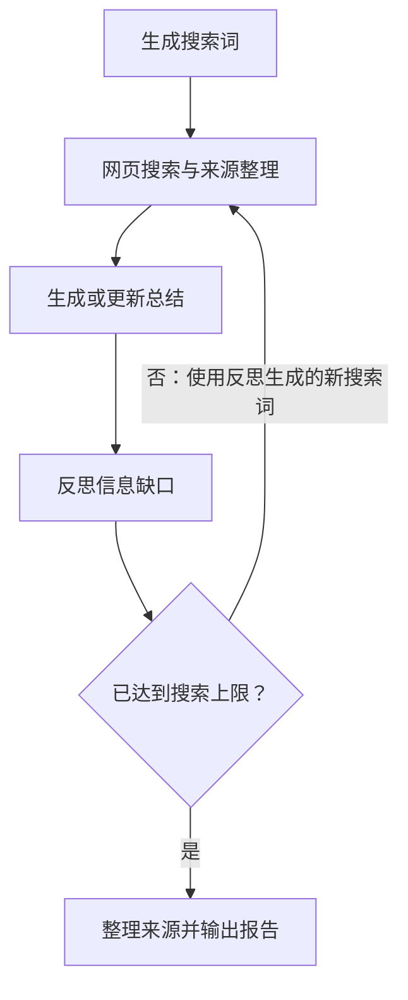

# InsightFlow

面向工业数字化研究的 AI 助手原型。
输入研究主题，自动搜索网页、整理资料、识别信息缺口，
输出带来源列表的中文 Markdown 报告。

当前版本：v0.1｜本地命令行原型

> 基于 langchain-ai/local-deep-researcher 二次开发。
> 本项目重点探索模型接入、搜索可靠性与研究输出的可追溯性，
> 尚未达到生产可用或研究结论自动核验的水平。

## 示例与开发记录

- [示例报告及阅读说明](examples/README.md)
- [制造业设备维护研究报告](examples/manufacturing-maintenance-report-v0.1.md)
- [开发过程与验证记录](docs/development-log.md)

## 为什么做这个项目

结合自身 MES 开发、需求沟通和上线支持经历，
我希望探索 AI 如何辅助工业场景的资料检索与技术调研。

本阶段围绕制造业设备维护知识问答开展实践：
将分散的网页资料整理为有来源的研究初稿，
同时识别资料不足、来源质量和模型生成中的问题。

## 工作流程


1. 根据研究主题生成搜索词。
2. 检索网页并整理摘要与来源。
3. 根据资料生成或更新总结。
4. 识别信息缺口，生成后续搜索问题。
5. 根据搜索轮数决定继续检索或结束。
6. 整理来源列表，将报告保存为 Markdown。

当前实现中，最后一轮仍会执行反思，
但生成的追问不会继续用于搜索。

## 开源基础与我的改进

原项目提供 LangGraph 状态管理、研究节点、
搜索集成和总结反思流程。

本阶段完成的主要改动：

| 改动 | 解决的问题 | 已有验证 |
| --- | --- | --- |
| 新增 OpenRouter 模型接入 | 使用可访问的模型服务运行工作流 | 通过独立调用、工具调用和完整运行验证 |
| 将搜索依赖迁移至 ddgs | 旧搜索库在本地测试中返回零结果 | 新依赖与项目搜索函数返回真实来源 |
| 添加空结果中断与诊断输出 | 没有资料时仍生成肯定语气的报告 | 空结果触发异常，停止后续生成 |
| 增加候选结果并过滤已知 Bing 广告链接 | 广告跳转链接混入研究来源 | 完成正常检索验证；广告拦截仍需固定样例测试 |
| 修正搜索次数判断 | 配置上限与实际搜索轮数不一致 | 一轮配置对应一轮实际搜索 |
| 调整引用方式 | 模型复制长网址时改写字符或遗漏参数 | 正文引用标题，末尾由程序附上原始链接 |
| 添加运行与报告保存脚本 | 方便本地运行和检查产出 | 成功输出 Markdown 报告 |

以上为功能验证记录，尚未形成系统性性能评测。

## 技术组成

- Python
- LangGraph：状态管理、节点编排与条件路由
- LangChain / ChatOpenAI：模型调用接口
- OpenRouter：模型服务接入
- Pydantic：结构化搜索词定义
- ddgs：网页搜索
- Markdown：报告与开发记录

当前使用网页搜索摘要作为外部信息来源，
尚未实现本地文档切分、Embedding 与向量库检索。

## 本地运行

以下命令适用于 Windows PowerShell，
请先进入项目根目录。

本项目本地实践使用 Python 3.12，
尚未验证其他 Python 版本下的完整运行兼容性。

### 1. 创建虚拟环境并安装依赖

```powershell
python -m venv .venv
.\.venv\Scripts\python.exe -m pip install -e .
```

### 2. 设置研究主题

打开 `run_insightflow.py`，修改 `topic`。

脚本中还可以调整：

- `LOCAL_LLM`：模型标识。
- `MAX_WEB_RESEARCH_LOOPS`：搜索轮数。
- `FETCH_FULL_PAGE`：是否尝试抓取网页全文。

本示例使用一轮搜索，并关闭全文抓取。

### 3. 运行

```powershell
.\.venv\Scripts\python.exe .\run_insightflow.py
```

程序读取 `OPENROUTER_API_KEY` 环境变量；
未设置时，会提示在终端中隐藏输入密钥。

需要自行准备 OpenRouter API Key。
模型可用性、额度与费用以服务方实时信息为准。
不要将密钥写入代码或提交至 Git。

### 4. 查看结果

报告保存在：

```text
outputs/mes_rag_report_日期_时间.md
```

`outputs/` 不纳入版本控制。
经过挑选的展示样例单独放在 `examples/`。

## 主要文件

| 文件 | 作用 |
| --- | --- |
| `run_insightflow.py` | 本地配置、启动流程、显示进度并保存报告 |
| `src/ollama_deep_researcher/graph.py` | 研究节点与流程连接 |
| `src/ollama_deep_researcher/state.py` | 研究主题、资料、来源和总结等状态 |
| `src/ollama_deep_researcher/configuration.py` | 模型与搜索配置 |
| `src/ollama_deep_researcher/utils.py` | 搜索、来源格式化等工具函数 |
| `src/ollama_deep_researcher/prompts.py` | 查询、总结和反思提示词 |

## 当前限制

- 主要依据搜索摘要，未系统核验网页全文。
- 搜索结果可能偏题、重复或包含营销内容。
- 广告过滤仅覆盖已知链接模式。
- 来源标题引用尚未实现自动匹配校验。
- 来源存在不代表每条结论都被来源支持。
- 搜索服务与模型输出可能变化，结果不保证完全复现。
- 尚无系统性准确率、时延或成本评测。
- 当前为命令行原型，尚未实现 Web 界面。

## 下一步计划

- 使用固定样例验证空结果保护与广告过滤。
- 选择三个固定主题，对比一轮与两轮搜索。
- 记录耗时、来源相关性、新增有效信息与引用支持情况。
- 引入来源编号及程序校验，减少引用错误。
- 根据评估结果决定是否增加全文抓取与文档检索。

## 致谢与许可证

本项目基于以下开源项目二次开发：

https://github.com/langchain-ai/local-deep-researcher

保留上游 MIT 许可证及版权声明，详见仓库中的 LICENSE。
原始项目说明备份见：

[上游 README](docs/upstream-README.md)