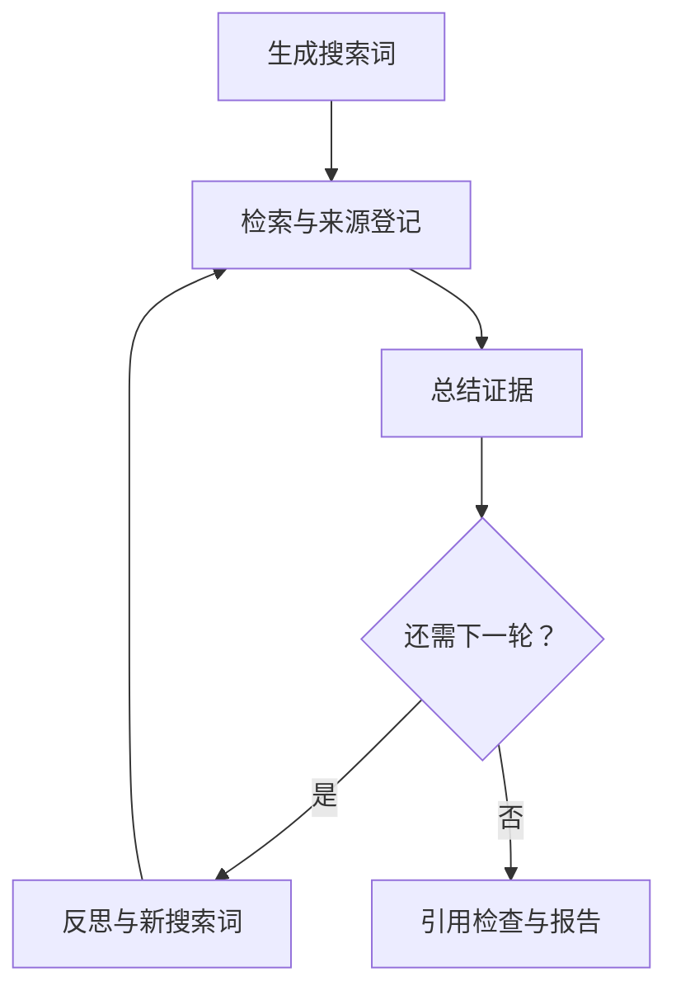

# InsightFlow v0.2：来源管理、引用检查与运行反馈

基于 langchain-ai/local-deep-researcher 的二次开发。保留原项目许可证和归属说明。

## 本次改进

| 问题 | 实现 | 边界 |
| --- | --- | --- |
| 同一网址因标题不同被重复列出 | 任务内来源注册表与稳定的 S1、S2 编号 | 网址去重不等于独立研究去重 |
| 多轮检索中重复来源仍有新摘要 | 同一来源保存分轮 observations | 不丢弃后续摘要 |
| 模型生成的网址可能改变 | 提示词使用 [S1] 引用，程序生成来源列表 | 正文出现网址会告警，不自动证明内容正确 |
| 引用缺少验证 | 检查未知编号、无编号引用、正文网址；记录未引用来源 | 不检测全部事实是否受支持，也不计算事实准确率 |
| 最后一轮仍调用反思 | 总结后判断轮数，只有继续检索才反思 | 模拟测试中一轮 2 次、两轮 4 次模型调用；不是线上延迟结论 |
| 等待时难以判断进度 | 节点开始提示，每 15 秒打印等待信息 | 心跳不代表服务有响应，也不是超时中断机制 |
| 结果难复查 | 保存 sources.json、citation-check.json、事件、元数据与报告 | 公开前人工检查内容 |

## 工作流



## 验证记录

使用用户保存的 v0.1 两轮事件进行离线回放：6 条来源记录合并为 5 个网址，重复网址的两轮摘要均保留。

6 个 unittest 测试覆盖：稳定编号和摘要保留、引用异常、空证据、保守网址归一化、历史日志回放、实际编译工作流的模拟服务执行。

模拟测试替换模型和搜索服务，不调用真实 API。它证明流程路由与数据处理符合测试预期，不证明模型质量或线上性能。真实 API 回归待用户执行。

v0.1 单次运行耗时分别为 170.831 秒和 387.345 秒；样本少且搜索词不同，仅作探索性记录。v0.2 未测得线上耗时，不能宣称提速比例。

## 当前限制

当前启动脚本固定为搜索摘要模式，证据登记使用 content 摘要，不利用 raw_content 全文。不要将报告描述为全文核验。其他搜索服务未完成线上回归。

网址归一化只处理主机大小写及 fragment，保留查询参数和版本信息；同一论文在 arXiv、出版商和聚合网站的页面仍可能作为多个来源。后续可加入 DOI/论文身份识别。

引用检查 passed 仅表示未触发既定格式告警。未引用来源只记录，不强迫模型引用无关材料。未知引用会在报告中保留并告警，需人工处理后再展示。

## GitHub 展示建议

在根 README 加入：

```markdown
## v0.2 更新

新增来源编号与网址去重、引用格式检查、等待进度提示，并移除最后一轮的多余反思调用。

- [改进与验证说明](docs/v0.2-changes.md)
- 真实 API 对比结果：待补充
```

实测后新增 examples/evaluation-v0.2/，仅复制审阅后的报告、来源和引用检查文件。保留 v0.1 示例，方便比较。记录本次实际耗时、来源数和引用告警；不要提前填写提升数字。
